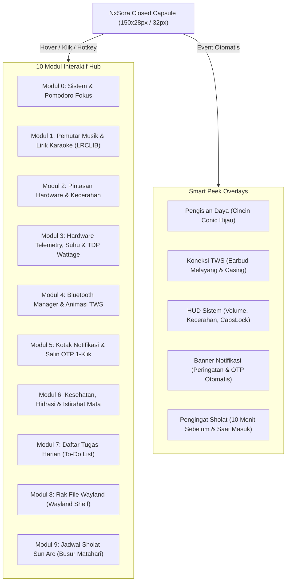

# 🌌 NxSora (Nx空)

> **The Living Sky-Notch for Linux Desktop (KDE Plasma 6 Wayland)**  
> *Mahkota cerdas di cakrawala desktop Linux Anda, perpaduan presisi komputasi NXRts dan estetika angkasa Jepang.*

---

## 🧭 1. Identitas & Profil Proyek

| Atribut | Keterangan |
| :--- | :--- |
| **Nama Resmi** | **NxSora** (dibaca: *En-Eks-So-Ra*) |
| **Nama Kanji / Simbol** | **Nx空** (*ンクス・ソラ*) |
| **Nama Binary / CLI** | **`nxsora`** |
| **Kreator & Pengembang** | **NXRts** |
| **Tagline** | *The Living Sky-Notch for Linux Desktop* |
| **Platform Target** | CachyOS / Arch Linux (KDE Plasma 6 Wayland) |
| **Teknologi Inti** | Python 3, PyQt6, QML (QtQuick 2), Wayland Layer-Shell (`layer-shell-qt`) |
| **Sistem Suara & IPC** | PipeWire / WirePlumber (`wpctl`), D-Bus (`org.bluez`, `org.freedesktop.Notifications`, MPRIS) |
| **Repositori Proyek** | [`github.com/NXRts/Projek-Dynamic-Island`](https://github.com/NXRts/Projek-Dynamic-Island) *(Arah rilis paket: `nxsora`)* |
| **Paket AUR Target** | `nxsora` / `nxsora-git` |

---

## 🌸 2. Filosofi & Asal-Usul Nama "NxSora"

Nama **NxSora** lahir dari perkawinan dua entitas: **Nx** (identitas kreator **NXRts** dan visi *Next-Gen*) serta **Sora (空)** (filosofi Jepang tentang langit, cakrawala, dan keheningan kosmik).

```
                   ☁️ Cakrawala Langit Desktop (The Sky)
                           ▲
                           │
       ────────────────────┼────────────────────  Top Panel Desktop
                     ┌─────┴─────┐
                     │  NxSora   │  (Nx空 - The Sky Notch)
                     └───────────┘
                           │
                           ▼
                 🖥️ Area Kerja Pengguna (Earth / Earthly Workspace)
```

Pemilihan nama ini memuat 4 pilar filosofis:

### 1. Langit di Puncak Monitor (*The Desktop Canopy*)
Dalam bahasa Jepang, **Sora (空)** berarti **Langit** atau **Cakrawala Luas**.  
Notch ini bersemayam tepat di titik tertinggi desktop Anda—layaknya kubah langit yang memayungi seluruh jendela aplikasi. Di "langit" inilah:
- Busur matahari waktu sholat (*Sun Arc*) terbit, melintas, dan terbenam.
- Bintang-bintang notifikasi berkilau saat ada pesan atau kode OTP masuk.
- Mata maskot yang hidup (*Living Mascot*) memandang ramah ke bawah, menemani setiap jam kerja dan sesi koding Anda.

### 2. Konsep Zen: Dari Keheningan ke Dinamika (*Kū to Ryū — 空から流へ*)
Kanji **空** dalam ajaran Zen dan seni rupa Jepang juga dapat dibaca sebagai **Kū** (*kekosongan yang lapang / keheningan bernyawa*):
- **Saat Hening (Idle)**: NxSora tampil minimalis tak kasat mata di latar belakang. Ia tidak mencuri perhatian, tidak memakan daya prosesor (**0.0% CPU**), dan memiliki sifat tembus klik penuh (**100% Click-Through**) sehingga tidak menghalangi tab browser ataupun editor koding.
- **Saat Dibutuhkan (Flow/Fluidity)**: Layaknya awan yang dinamis, ia mengembang anggun (*spring-physics expansion*) menghadirkan 10 modul produktivitas hanya dalam satu ketukan atau hover kursor.

### 3. Tanda Tangan & Jiwa NXRts (*The Nx Identity*)
Awalan **Nx** merupakan singkatan langsung dari nama dan identitas **NXRts**:
- Menandai orisinalitas 100% karya pribadi, bebas dari tiruan nama pasaran.
- Melambangkan **Next-Generation UX**—bahwa pengguna Linux berhak mendapatkan antarmuka desktop yang estetik, luwes, dan jauh lebih modern daripada desktop konvensional.
- Memberikan nama binary CLI yang ringkas, berwibawa, dan sangat nyaman diketik di terminal: `nxsora`.

### 4. Harmoni Waktu & Keseimbangan Hidup (*Ten no Toki — 天の時*)
NxSora bukan sekadar alat pemantau hardware. Dengan modul **Sun Arc Kemenag RI**, **Pomodoro Fokus**, dan **Pengingat Air Minum**, NxSora membawa filosofi hidup seimbang antara kerja keras di depan komputer dan kesadaran waktu istirahat serta ibadah.

---

## 🎨 3. Identitas Visual & Bahasa Desain (Design Language)

NxSora mengusung bahasa desain **Neo-Sora Minimalist**: perpaduan kontras hitam pekat (*deep void*) dengan pendaran aksen warna alami Jepang (*Japanese Nature Hues*).

### Palet Warna Khas NxSora (Sora Color Palette)

```
┌─────────────────┬─────────────────┬─────────────────┬─────────────────┐
│    Sora Void    │    Sora Cyan    │   Hinode Gold   │   Shinrin Mint  │
│     #07070a     │     #38bdf8     │     #fbbf24     │     #22c55e     │
│  (Latar Notch)  │ (Fokus & Aksen) │ (Matahari/Notif)│(Baterai & Normal)│
├─────────────────┼─────────────────┼─────────────────┼─────────────────┤
│   Sakura Flame  │    Ryū Blue     │   Fuji Violet   │   Sora Border   │
│     #f43f5e     │     #5ec2ff     │     #818cf8     │     #24273a     │
│ (TDP & Musik)   │ (Bluetooth/TWS) │ (Shelf & File)  │  (Border Kartu) │
└─────────────────┴─────────────────┴─────────────────┴─────────────────┘
```

### Karakteristik Fisik Notch
- **Concave Ear Curves**: Lengkungan telinga luar dengan radius kurva `12px` di kiri dan kanan atas yang melebur sempurna (*flush margin 0*) menempel di bawah panel KDE Plasma.
- **Organic Fluid Morphing**: Transisi dari kapsul tertutup (`150x28px`), mode HUD (`310x60px`), hingga Hub Penuh (`440x245px`) dijalankan oleh interpolasi kurva pegas elastis (*elastic easing*).
- **Glanceable Glassmorphism**: Kartu berlatar gelap `#12131c` dengan sudut melengkung `10px` dan garis outline halus `1.5px` beradaptasi sesuai status aktif (cyan untuk lagu, merah untuk suhu tinggi, biru untuk bluetooth, kuning untuk azan).

---

## 🧩 4. Arsitektur 10 Modul Terpadu NxSora

NxSora menyatukan 10 modul independen dalam satu kesatuan sistem:



### Rincian 10 Modul Unggulan:

1. **Modul 0 — Sistem & Pomodoro Fokus**
   - Meteran penggunaan CPU, RAM, dan Baterai *real-time*.
   - Timer Pomodoro dengan cincin pendaran melingkar (*Glowing Conic Ring*), mode *Fokus 25:00* ↔ *Istirahat 05:00*, dan notifikasi suara lembut (*soft bell chime*).
2. **Modul 1 — Pemutar Musik & Lirik Karaoke (MPRIS + LRCLIB)**
   - Mendukung pemutar media desktop (Spotify, Firefox, Chrome, VLC, Sayonara, dll.).
   - Sampul album, bilah durasi interaktif, dan panel lirik karaoke sinkron per baris (*expanded 520px Split View*) dengan fitur loncat lagu saat baris lirik diklik.
3. **Modul 2 — Pintasan Cepat Hardware**
   - Slider kecerahan monitor laptop (`amdgpu_bl1`), pengatur volume PipeWire, sakelar mikrofon bisu, Wi-Fi toggle, dan tombol uji coba peek animasi.
4. **Modul 3 — Hardware Telemetry, Suhu & Processor TDP (Suite Lengkap)**
   - **Processor Package Power / TDP**: Menampilkan daya riil prosesor dalam Watt (`PPT`) langsung dari sensor kernel `hwmon`.
   - **Multi-Sensor Suhu**: CPU (`k10temp`), GPU (`amdgpu`), dan SSD NVMe (`°C`) dengan status oval adaptif (Hijau `<65°C`, Kuning `65-84°C`, Merah `≥85°C`).
   - **Top Process Monitor**: Menampilkan proses terberat yang memakan sumber daya sistem (misal: `kwin_wayland`, `firefox`).
   - **1-Click Power Profile Switcher**: Sakelar instan 🍃 Hemat, ⚖️ Seimbang, dan 🚀 Performa via `powerprofilesctl`.
5. **Modul 4 — Bluetooth Manager & Animasi TWS**
   - Integrasi D-Bus BlueZ (`org.bluez`).
   - Animasi lepas-pasang casing dan earbud melayang saat TWS terhubung atau terputus.
   - Manajemen perangkat terhubung dan pemantauan level baterai earbud kiri/kanan/casing.
6. **Modul 5 — Pusat Notifikasi & 1-Click Salin OTP**
   - Menangkap notifikasi sistem ke dalam riwayat 40 notifikasi terakhir dengan kategorisasi otomatis (💬 Pesan, 🎵 Media, ⚡ Suhu, 🎯 Fokus, 🌐 Web).
   - Pendeteksi kode verifikasi/OTP cerdas: tombol **📋 Salin OTP** langsung menyalin kode angka ke clipboard Wayland (`wl-copy`).
   - **Smart Timestamp & Auto-Expire**: Format waktu pintar (*Hari ini: jam:menit*, *Kemarin: Kemarin, jam:menit*) serta pembersihan otomatis sampah notifikasi lama (>24-48 jam) saat sistem dinyalakan via Autostart boot PC.
   - Sakelar **🔕 Mode Jangan Ganggu (DND)**.
7. **Modul 6 — Kesehatan, Hidrasi & Eye Break**
   - Pelacak asupan air harian target 2000 ml dengan diagram batang per jam (`09:00 - 16:00`), tombol cepat (+250 ml), dan pengingat istirahat mata aturan 20-20-20.
8. **Modul 7 — Daftar Tugas Harian (To-Do)**
   - Buku catatan tugas harian tersimpan otomatis ke berkas lokal JSON, fitur coret saat selesai, dan penambahan cepat tugas baru.
9. **Modul 8 — Rak File Sementara Wayland (Shelf)**
   - Area seret-dan-lepas (*drag & drop*) file sementara dengan animasi *"Island Gulp"*.
   - Pratinjau thumbnail gambar asli dan kemampuan seret kembali keluar (**Native Wayland `QDrag` `text/uri-list`**) ke aplikasi tujuan.
10. **Modul 9 — Jadwal Sholat Sun Arc (Day Trajectory)**
    - Busur lengkung dinamis lintasan matahari melintasi langit hari (*parabolic day trajectory*).
    - Penanda matahari bercahaya (*dynamic glowing sun*), hitung mundur waktu berikutnya (`Maghrib 17:52 in 1 h 12 min`), dan timeline 5 waktu.
    - Notifikasi kepala tenang (*quiet heads-up*) 10 menit sebelum adzan dan pop-up tenang saat waktu sholat tiba.
    - Kalkulasi matematis 100% lokal offline di PC berdasarkan metode resmi Kemenag RI tanpa memerlukan internet.

---

## 🛠️ 5. Standarisasi Perintah CLI & Ekosistem Linux

Untuk mempermudah penggunaan di terminal maupun pengikatan ke pintasan keyboard global (*Global Shortcuts*):

### 1. Perintah Binary CLI (`nxsora`)
```bash
# Menjalankan di latar depan (foreground)
nxsora

# Menjalankan sebagai daemon latar belakang (rekomendasi harian)
nxsora --daemon

# Menutup atau mematikan daemon yang berjalan
nxsora --stop

# Me-restart NxSora (memuat ulang konfigurasi & QML)
nxsora --restart

# Buka / Tutup Hub interaktif secara instan (sangat cocok untuk hotkey global)
nxsora --toggle

# Membuka halaman spesifik secara langsung
nxsora --page hardware
nxsora --page prayer
nxsora --page music

# Menampilkan status proses, PID, dan konsumsi memori
nxsora --status

# Pengecekan dependensi sistem dan sesi Wayland
nxsora --check
```

### 2. Standarisasi Direktori XDG
NxSora mematuhi standar direktori XDG Linux agar berkas pengguna tetap rapi:
- **Konfigurasi Utama**: `$XDG_CONFIG_HOME/nxsora/config.json` (fallback: `~/.config/nxsora/`)
- **Basis Data & State**: `$XDG_STATE_HOME/nxsora/notifications.json` *(izin aman `chmod 600`)*
- **Cache Data & Lirik**: `$XDG_CACHE_HOME/nxsora/lyrics/` & `prayer_cache.json`
- **Catatan Log**: `$XDG_STATE_HOME/nxsora/nxsora.log`

### 3. Layanan Systemd User Service
NxSora dapat dijalankan otomatis bersamaan dengan sesi desktop KDE Plasma:
```ini
# ~/.config/systemd/user/nxsora.service
[Unit]
Description=NxSora - The Living Sky-Notch for KDE Plasma 6 Wayland
PartOf=graphical-session.target
After=plasma-workspace.target

[Service]
ExecStart=/usr/bin/nxsora --daemon
Restart=on-failure
RestartSec=3

[Install]
WantedBy=graphical-session.target
```

Aktivasi layanan:
```bash
systemctl --user enable --now nxsora.service
```

---

## 🚀 6. Roadmap Pengembangan NxSora

| Versi | Sandi Rilis | Fokus Utama |
| :--- | :--- | :--- |
| **v0.1.0** | **Sora Dawn (空の夜明け)** | Stabilitas 9 halaman Hub, hardware telemetry suite, lirik karaoke, shelf Wayland, dan integrasi awal CLI. |
| **v0.2.0** | **Hinode Arc (日の出)** | Integrasi penuh Modul Jadwal Sholat Sun Arc offline Kemenag RI, privacy indicator dots, dan system tray menu. |
| **v0.3.0** | **Mirai Flow (未来の流れ)** | Halaman Pengaturan Terpadu (`qml/PageSettings.qml`), global hotkey D-Bus, dan kustomisasi aksen warna. |
| **v1.0.0** | **NxSora Pure (完全なる空)** | Rilis stabil jangka panjang, paket resmi Arch User Repository (AUR), dan pengoptimalan CachyOS x86-64-v4. |

---

*Dokumen ini merupakan acuan resmi filosofi, identitas merek, spesifikasi teknis, dan rancangan pengembangan produk untuk **NxSora (Nx空)**.*  
*Dibuat dengan bangga oleh **NXRts**.*

