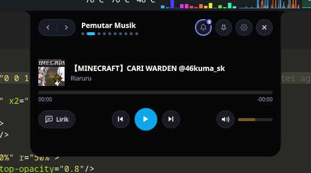

# 🌌 NxSora (Nx空) — The Living Sky-Notch for Linux Desktop

<p align="center">
  
</p>

<p align="center">
  <strong>An intelligent canopy for your Linux desktop horizon, blending modern productivity tools with fluid Wayland aesthetics.</strong>
</p>

<p align="center">
  <a href="https://kde.org/"></a>
  <a href="https://wayland.freedesktop.org/"></a>
  <a href="https://www.python.org/"></a>
  <a href="https://riverbankcomputing.com/software/pyqt/"></a>
  <a href="LICENSE"></a>
  <a href="https://github.com/NXRts/NxSora/actions/workflows/ci.yml"></a>
  <a href="packaging/aur/PKGBUILD"></a>
</p>

<p align="center">
  <a href="README.md"><strong>Bahasa Indonesia</strong></a> | <a href="README.en.md"><strong>English</strong></a>
</p>

<p align="center">
  
</p>

---

## 🧭 Document Navigation
- 🗺️ **Public Roadmap**: [`ROADMAP.md`](ROADMAP.md) — Phased development plans and feature status.
- 📜 **Changelog**: [`CHANGELOG.md`](CHANGELOG.md) — Release notes and version history for `v0.1.0`.
- 🤝 **Contributing**: [`CONTRIBUTING.md`](CONTRIBUTING.md) — Development guidelines, tests, and pull request workflow.
- 🌌 **Design & Philosophy**: [`docs/NXSORA.md`](docs/NXSORA.md) — Identity origin, Neo-Sora design language, and color palette.
- 🔬 **Master Plan & Architecture**: [`docs/NEXT.md`](docs/NEXT.md) — In-depth architectural analysis and dynamic island ecosystem comparison.
- 📖 **User Tutorial**: [`docs/TUTORIAL.md`](docs/TUTORIAL.md) — Gestures, navigation, and keyboard shortcuts.

---

## ⚡ Performance & Resource Efficiency
NxSora is engineered for low overhead on modern Linux desktops:
- **Low CPU Overhead**: **< 0.5% CPU** when idle (60-second average benchmark on CachyOS Linux, AMD Ryzen / Intel Core i5 during resting capsule state).
- **Lightweight Memory Footprint**: **~85 MB RAM** (QtQuick 2 QML rendering with single Python background daemon).
- **100% Click-Through**: Screen space outside the physical notch geometry is completely click-through and will never intercept mouse events destined for your workspace.
- **Wayland Native**: Anchored via the `layer-shell-qt` protocol on the `LayerOverlay` surface.

---

## ✨ 10 Integrated Pages

1. **Resting Mascot Eyes & Closed Capsule (`150x28px`)**:
   - Living mascot eyes with **Cursor Eye-Tracking** (subtle glance towards mouse cursor near the notch) and periodic blinking.
   - Digital clock mode with **Circular Battery Ring (`#33e07a`)** and **Privacy Dots** (active camera green dot & microphone orange dot via PipeWire).
2. **Music Player & Synced Karaoke Lyrics (`420px → 520px` Split View)**:
   - Album art, interactive seekbar (`MM:SS` & remaining `-MM:SS`), and automatic synced lyrics via **LRCLIB**.
   - **Click-to-Seek**: click any lyric line to instantly jump to that point in the track.
3. **Quick Controls**:
   - PipeWire volume, laptop display brightness slider, microphone mute toggle, and animation test triggers.
4. **Hardware, Temperature & Processor TDP Telemetry**:
   - **Processor Package Power / TDP (Watts)** directly read from kernel `/sys/class/hwmon` (or estimated with `~` prefix if sensor absent).
   - Multi-sensor temperature monitoring for **CPU (`k10temp`), GPU (`amdgpu/nvidia`), and SSD NVMe**, clock GHz, GPU load, heaviest process (*Top CPU*), and high-temperature warnings (`≥85°C`).
   - 1-Click **Power Profile Switcher**: 🍃 Power Saver, ⚖️ Balanced, 🚀 Performance (`powerprofilesctl`).
5. **Bluetooth & TWS Earbuds Hub**:
   - Connected via **BlueZ D-Bus (`org.bluez`)** with **animated TWS pop-up (`310x60px`)** on connect/disconnect.
   - Paired device list, per-device battery percentage, and 1-click connect/disconnect buttons.
6. **Split-View Notification Center**:
   - History of the 40 most recent notifications with auto-categorization (💬 Chat, 🎵 Media, ⚡ System, 🎯 Focus, 🌐 Browser).
   - **📋 Copy OTP** button, **🔕 Do Not Disturb** mode, unread count badge, **Smart Relative Timestamps** (Today / Yesterday), and auto-cleanup of expired notifications (>48 hours).
   - **Privacy Guard**: Files stored with strict `0600` permissions and automatically rejects notifications from Password Managers (*KeePassXC, Bitwarden, 1Password, Proton Pass, Enpass*).
7. **Health & Hydration Tracker**:
   - **8-Hour Daily Water Histogram**, custom glass sizes (`150–500ml`), daily target (`1.5–3.0L`), and **20-20-20 Eye Break** reminders.
8. **Daily To-Do Checklist**:
   - Lightweight task checklist manager persisted locally in JSON.
9. **Wayland File Shelf (Drag & Drop)**:
   - Drag files from Dolphin or file managers to the top notch to stash them temporarily (*Island Gulp effect*).
   - Image thumbnail previews and drag-out capability (**Native Wayland `QDrag` `text/uri-list`**) into chat, browsers, or directories.
10. **Settings & Customization**:
    - Per-HUD toggles (Volume, Battery, Bluetooth, Caps Lock, Notifications).
    - **Fullscreen Auto-Hide**: automatically hides the notch when fullscreen games or videos are running.
    - **System Tray Icon**: status menu in the KDE Plasma panel to toggle the Hub, change mascot mode, or quit.

---

## 📦 Installation

### Option A: Local PKGBUILD (Arch Linux / CachyOS)
```bash
# 1. Clone the repository
git clone https://github.com/NXRts/NxSora.git
cd NxSora/packaging/aur

# 2. Build and install locally
makepkg -si
```
*(Note: The `nxsora-git` package is ready for AUR submission).*

### Option B: Manual Installation via Script
```bash
# 1. Clone the repository
git clone https://github.com/NXRts/NxSora.git
cd NxSora

# 2. Ensure ~/.local/bin is in your PATH
export PATH="$HOME/.local/bin:$PATH"

# 3. Check system dependencies
./run.sh --check

# 4. Install desktop launcher & autostart
./install.sh
```

---

## 🚀 CLI Usage & Commands

```bash
# Run in background (safe daemon)
nxsora --daemon

# Check status, PID, and memory usage
nxsora --status

# Restart the application (reload configuration & QML)
nxsora --restart

# Toggle the interactive Hub (ideal for global keyboard shortcuts)
nxsora --toggle

# Stop the application
nxsora --stop

# Send a test notification to the notch
nxsora --test-notif
```

---

## ⚙️ Systemd Service (Optional)

If you prefer managing NxSora via user systemd:

```ini
# ~/.config/systemd/user/nxsora.service
[Unit]
Description=NxSora - The Living Sky-Notch for KDE Plasma 6 Wayland
PartOf=graphical-session.target
After=plasma-workspace.target

[Service]
Type=simple
ExecStart=%h/.local/bin/nxsora
Restart=on-failure
RestartSec=3

[Install]
WantedBy=graphical-session.target
```

Enable the service:
```bash
systemctl --user daemon-reload
systemctl --user enable --now nxsora.service
```

> [!WARNING]
> **Important**: Choose either desktop autostart (`~/.config/autostart/nxsora.desktop` created by `./install.sh`) **or** the systemd user service. Do not enable both simultaneously to avoid duplicate instances.

---

## 🔧 XDG Directory Compliance
- **Configuration**: `~/.config/nxsora/config.json`
- **Cache (Lyrics & Artwork)**: `~/.cache/nxsora/lyrics/`
- **Logs**: `~/.local/state/nxsora/nxsora.log`
- **Lock & Runtime**: `/run/user/<UID>/nxsora/nxsora.lock`

---

## ❓ Frequently Asked Questions (FAQ)

<details>
<summary><strong>1. Notch doesn't attach to the top edge or overlaps other panels?</strong></summary>
Ensure you are in a <strong>Wayland</strong> session. NxSora utilizes <code>layer-shell-qt</code> for exact layer positioning. Adjust top margin in <code>~/.config/nxsora/config.json</code> (property <code>top_margin</code>).
</details>

<details>
<summary><strong>2. Desktop notifications are not caught by NxSora?</strong></summary>
Ensure <code>dbus-monitor</code> is installed. NxSora passively listens to <code>org.freedesktop.Notifications</code> without overriding KDE Plasma's notification daemon.
</details>

<details>
<summary><strong>3. Bluetooth TWS battery status is not displayed?</strong></summary>
Ensure BlueZ experimental Battery1 support is active on your system. Most modern earbuds automatically broadcast battery information over Bluetooth D-Bus.
</details>

<details>
<summary><strong>4. Processor TDP displays a "~" prefix?</strong></summary>
A <code>~</code> indicates that TDP is estimated from CPU workload because the kernel does not expose a <code>power1_input</code> sensor in <code>/sys/class/hwmon</code>.
</details>

<details>
<summary><strong>5. Does eye-tracking follow the cursor anywhere on screen?</strong></summary>
Under Wayland security boundaries, reading global mouse coordinates is restricted; mascot eye gaze precisely tracks the cursor as it moves near the notch interaction boundaries.
</details>

---

## 🙏 Credits & Acknowledgments

This project is inspired by the interactive dynamic island concept **[Nusa](https://rama2555.github.io/nusa/)** designed by **Rama ([@rama2555](https://github.com/rama2555))**.

NxSora adapts and re-engineers the concept from scratch into a native desktop application for **Linux KDE Plasma 6 (Wayland)** using Python, PyQt6, QtQuick QML, PipeWire, BlueZ, and Wayland Layer-Shell.

---

## 📄 License
Distributed under the **GNU General Public License v3.0 (GPL-3.0)**. See the [`LICENSE`](LICENSE) file for details.

Developed by **[NXRts](https://github.com/NXRts)** — Inspired by **[Nusa](https://rama2555.github.io/nusa/)**.
