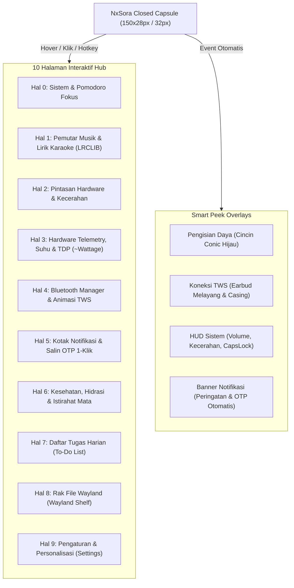

# 🌌 NxSora (Nx空) — Spesifikasi Desain & Filosofi

> **The Living Sky-Notch for Linux Desktop (KDE Plasma 6 Wayland)**  
> *Mahkota cerdas di cakrawala desktop Linux Anda, perpaduan presisi komputasi NXRts dan estetika angkasa Jepang.*

---

## 🧭 1. Identitas & Profil Proyek

| Atribut | Keterangan |
| :--- | :--- |
| **Nama Resmi** | **NxSora** (dibaca: *En-Eks-So-Ra*) |
| **Nama Kanji / Simbol** | **Nx空** (*エヌエックス・ソラ*) |
| **Nama Binary / CLI** | **`nxsora`** |
| **Kreator & Pengembang** | **NXRts** |
| **Kredit Inspirasi** | Terinspirasi oleh konsep antarmuka **[Nusa](https://rama2555.github.io/nusa/)** oleh **Rama ([@rama2555](https://github.com/rama2555))** |
| **Tagline** | *The Living Sky-Notch for Linux Desktop* |
| **Platform Target** | CachyOS / Arch Linux / openSUSE / Fedora (KDE Plasma 6 Wayland) |
| **Teknologi Inti** | Python 3, PyQt6, QML (QtQuick 2), Wayland Layer-Shell (`layer-shell-qt`) |
| **Sistem Suara & IPC** | PipeWire / WirePlumber (`wpctl`), D-Bus (`org.bluez`, `org.freedesktop.Notifications`, MPRIS) |
| **Repositori Resmi** | [`github.com/NXRts/NxSora`](https://github.com/NXRts/NxSora) |
| **Paket AUR (Arch)** | `nxsora-git` (PKGBUILD lokal di `packaging/aur/`) |

---

## 🌸 2. Filosofi & Asal-Usul Nama "NxSora"

Nama **NxSora** lahir dari perpaduan identitas kreator **NXRts** (*Next-Gen UX*) serta filosofi Jepang **Sora (空)** (langit, cakrawala, dan keheningan kosmik).

```
                   ☁️ Cakrawala Langit Desktop (The Sky)
                           ▲
                           │
       ────────────────────┼────────────────────  Top Panel Desktop
                     ┌─────┴─────┐
                     │  NxSora   │  (Nx空 - The Sky Notch)
                     └───────────┘
                           │
                           ▼
                 🖥️ Area Kerja Pengguna (Earth / Earthly Workspace)
```

### 4 Pilar Filosofis:

1. **Langit di Puncak Monitor (*The Desktop Canopy*)**:  
   Notch bersemayam tepat di titik tertinggi desktop—layaknya kubah langit yang memayungi seluruh jendela aplikasi:
   - Notifikasi berkilau saat ada pesan atau kode OTP masuk.
   - Mata maskot yang hidup (*Living Mascot*) memandang ramah ke bawah menemani sesi kerja Anda.
2. **Konsep Zen: Dari Keheningan ke Dinamika (*Kū to Ryū — 空から流へ*)**:  
   - **Saat Hening (Idle)**: NxSora tampil minimalis di latar belakang. Tidak mencuri perhatian, pemakaian daya CPU sangat rendah (**<0.5% CPU Idle**), dan memiliki sifat tembus klik penuh (**100% Click-Through**) sehingga tidak menghalangi tab browser ataupun editor.
   - **Saat Dibutuhkan (Flow/Fluidity)**: Mengembang anggun (*spring-physics expansion*) menyajikan 10 modul produktivitas hanya dalam satu ketukan atau hover kursor.
3. **Sentuhan Identitas NXRts & Dedikasi Open-Source**:  
   - Membawa antarmuka desktop modern ke ekosistem Linux Wayland dengan binary CLI yang ringkas: `nxsora`.
4. **Harmoni Waktu & Keseimbangan Hidup (*Ten no Toki — 天の時*)**:  
   - Menyediakan timer Pomodoro Fokus, pengingat hidrasi air minum, dan eye-break 20-20-20 demi menjaga kesehatan pengguna.

---

## 🎨 3. Identitas Visual & Bahasa Desain (Design Language)

NxSora mengusung bahasa desain **Neo-Sora Minimalist**: perpaduan kontras hitam pekat (*deep void*) dengan pendaran aksen warna alami Jepang (*Japanese Nature Hues*).

### Palet Warna Khas NxSora

```
┌─────────────────┬─────────────────┬─────────────────┬─────────────────┐
│    Sora Void    │    Sora Cyan    │   Hinode Gold   │   Shinrin Mint  │
│     #07070a     │     #38bdf8     │     #fbbf24     │     #22c55e     │
│  (Latar Notch)  │ (Fokus & Aksen) │ (Matahari/Notif)│(Baterai & Normal)│
├─────────────────┼─────────────────┼─────────────────┼─────────────────┤
│   Sakura Flame  │    Ryū Blue     │   Fuji Violet   │   Sora Border   │
│     #f43f5e     │     #5ec2ff     │     #818cf8     │     #24273a     │
│ (TDP & Musik)   │ (Bluetooth/TWS) │ (Shelf & File)  │  (Border Kartu) │
└─────────────────┴─────────────────┴─────────────────┴─────────────────┘
```

### Karakteristik Fisik Notch
- **Concave Ear Curves**: Lengkungan telinga luar dengan radius kurva `12px` di kiri dan kanan atas yang melebur sempurna (*flush margin 0*) menempel di bawah panel KDE Plasma.
- **Organic Fluid Morphing**: Transisi dari kapsul tertutup (`150x28px`), mode HUD (`310x60px`), hingga Hub Penuh (`420x245px` / `520x245px`) dijalankan oleh interpolasi kurva pegas elastis (*elastic easing*).
- **Glanceable Glassmorphism**: Kartu berlatar gelap `#12131c` dengan sudut melengkung `10px` dan garis outline halus `1.5px` beradaptasi sesuai status aktif (cyan untuk lagu, merah untuk suhu tinggi, biru untuk bluetooth).

---

## 🧩 4. Arsitektur 10 Halaman Terpadu NxSora (v0.1.0)

NxSora menyatukan 10 halaman interaktif dalam satu kesatuan sistem:



### Rincian 10 Halaman:

1. **Halaman 0 — Sistem & Pomodoro Fokus**:
   - Meteran penggunaan CPU, RAM, dan Baterai *real-time*.
   - Timer Pomodoro dengan cincin pendaran melingkar (*Glowing Conic Ring*), mode *Fokus 25:00* ↔ *Istirahat 05:00*, dan notifikasi suara lembut (*soft bell chime*).
2. **Halaman 1 — Pemutar Musik & Lirik Karaoke (MPRIS + LRCLIB)**:
   - Mendukung pemutar media desktop (Spotify, Firefox, Chrome, VLC, Sayonara, dll.).
   - Sampul album, bilah durasi interaktif, dan panel lirik karaoke sinkron per baris (*expanded 520px Split View*) dengan fitur loncat lagu saat baris lirik diklik.
3. **Halaman 2 — Pintasan Cepat Hardware**:
   - Slider kecerahan monitor laptop (`amdgpu_bl1`), pengatur volume PipeWire, sakelar mikrofon bisu, Wi-Fi toggle, dan tombol uji coba peek animasi.
4. **Halaman 3 — Hardware Telemetry, Suhu & Processor TDP**:
   - **Processor Package Power / TDP**: Menampilkan daya riil prosesor dalam Watt (`PPT`) langsung dari sensor kernel `hwmon` (atau estimasi bertanda `~` jika sensor absen).
   - **Multi-Sensor Suhu**: CPU (`k10temp`), GPU (`amdgpu/nvidia`), dan SSD NVMe (`°C`) dengan status oval adaptif (Hijau `<65°C`, Kuning `65-84°C`, Merah `≥85°C`).
   - **Top Process Monitor**: Menampilkan proses terberat yang memakan sumber daya sistem.
   - **1-Click Power Profile Switcher**: Sakelar instan 🍃 Hemat, ⚖️ Seimbang, dan 🚀 Performa via `powerprofilesctl`.
5. **Halaman 4 — Bluetooth Manager & Animasi TWS**:
   - Integrasi D-Bus BlueZ (`org.bluez`).
   - Animasi lepas-pasang casing dan earbud melayang saat TWS terhubung atau terputus.
   - Manajemen perangkat terhubung dan pemantauan level baterai earbud kiri/kanan/casing.
6. **Halaman 5 — Pusat Notifikasi & 1-Click Salin OTP**:
   - Riwayat 40 notifikasi terakhir dengan kategorisasi otomatis (💬 Pesan, 🎵 Media, ⚡ Suhu, 🎯 Fokus, 🌐 Web).
   - Pendeteksi kode verifikasi/OTP cerdas: tombol **📋 Salin OTP** langsung menyalin kode angka ke clipboard Wayland (`wl-copy`).
   - **Smart Timestamp & Auto-Expire**: Format waktu pintar (*Hari ini: jam:menit*, *Kemarin: Kemarin, jam:menit*) serta pembersihan otomatis sampah notifikasi lama (>48 jam).
   - **Privasi & Keamanan**: Izin berkas `0600` dan mengabaikan notifikasi dari aplikasi Password Manager (*KeePassXC, Bitwarden, 1Password, Proton Pass, Enpass*).
7. **Halaman 6 — Kesehatan, Hidrasi & Eye Break**:
   - Pelacak asupan air harian target 2000 ml dengan diagram batang per jam (`09:00 - 16:00`), tombol cepat (+250 ml), dan pengingat istirahat mata aturan 20-20-20.
8. **Halaman 7 — Daftar Tugas Harian (To-Do)**:
   - Buku catatan tugas harian tersimpan otomatis ke berkas lokal JSON, fitur coret saat selesai, dan penambahan cepat tugas baru.
9. **Halaman 8 — Rak File Sementara Wayland (Shelf)**:
   - Area seret-dan-lepas (*drag & drop*) file sementara dengan animasi *"Island Gulp"*.
   - Pratinjau thumbnail gambar asli dan kemampuan seret kembali keluar (**Native Wayland `QDrag` `text/uri-list`**) ke aplikasi tujuan.
10. **Halaman 9 — Pengaturan & Personalisasi (Settings)**:
    - Sakelar toggle untuk setiap Smart Peek HUD (Volume, Baterai, Bluetooth, Caps Lock, Notifikasi).
    - **Fullscreen Auto-Hide**: otomatis menyembunyikan notch saat game atau video layar penuh berjalan.
    - **Privacy Dots**: titik indikator mikrofon aktif (oranye) dan kamera aktif (hijau) via PipeWire.
    - **Cursor Eye-Tracking**: pupil mata maskot melirik mengikuti pergerakan kursor mouse saat berada di area interaktif notch.

---

## 🛠️ 5. Standarisasi Perintah CLI & Ekosistem Linux

### 1. Perintah Binary CLI (`nxsora`)
```bash
# Menjalankan di latar depan (foreground)
nxsora

# Menjalankan sebagai daemon latar belakang (rekomendasi harian)
nxsora --daemon

# Menutup atau mematikan daemon yang berjalan
nxsora --stop

# Me-restart NxSora (memuat ulang konfigurasi & QML)
nxsora --restart

# Buka / Tutup Hub interaktif secara instan (cocok untuk global shortcut)
nxsora --toggle

# Membuka halaman spesifik secara langsung
nxsora --page hardware
nxsora --page music

# Menampilkan status proses, PID, dan konsumsi memori
nxsora --status

# Pengecekan dependensi sistem dan sesi Wayland
nxsora --check
```

### 2. Standarisasi Direktori XDG
NxSora mematuhi standar direktori XDG Linux:
- **Konfigurasi Utama**: `$XDG_CONFIG_HOME/nxsora/config.json` (default: `~/.config/nxsora/`)
- **Basis Data & State**: `$XDG_STATE_HOME/nxsora/notifications.json` *(izin aman `0600`)*
- **Cache Data & Lirik**: `$XDG_CACHE_HOME/nxsora/lyrics/`
- **Catatan Log**: `$XDG_STATE_HOME/nxsora/nxsora.log`
- **Lock & Runtime**: `/run/user/<UID>/nxsora/nxsora.lock`

### 3. Layanan Systemd User Service
Jika Anda lebih memilih mengelola NxSora via Systemd daripada file autostart desktop:
```ini
# ~/.config/systemd/user/nxsora.service
[Unit]
Description=NxSora - The Living Sky-Notch for KDE Plasma 6 Wayland
PartOf=graphical-session.target
After=plasma-workspace.target

[Service]
Type=simple
ExecStart=%h/.local/bin/nxsora
Restart=on-failure
RestartSec=3

[Install]
WantedBy=graphical-session.target
```

Aktivasi layanan:
```bash
systemctl --user daemon-reload
systemctl --user enable --now nxsora.service
```

> [!WARNING]
> **PENTING**: Pilih salah satu antara autostart desktop (`~/.config/autostart/nxsora.desktop` dari `./install.sh`) **atau** unit systemd user service. Jangan mengaktifkan keduanya secara bersamaan agar tidak terjadi instans ganda.

---

## 🚀 6. Roadmap Pengembangan NxSora

| Versi | Status | Fokus Utama |
| :--- | :---: | :--- |
| **v0.1.0** *(Sora Dawn)* | **Rilis Saat Ini** | 10 Halaman Hub, Tray Menu, Privacy Dots, Eye-Tracking, XDG Paths, Fullscreen Auto-Hide, Installer, PKGBUILD, CI & 18 Unit Tests. |
| **v0.2.0** *(Sora Wave)* | Terjadwal | Real Audio Visualizer (PipeWire / Cava engine), Wi-Fi Peek status, Low-Battery Nudge. |
| **v0.3.0** *(Hinode Arc)* | Terjadwal | Jadwal Sholat Sun Arc lokal offline Kemenag RI, Voice Quick Note, Camera Mirror widget. |
| **v1.0.0** *(NxSora Pure)* | Masa Depan | Rilis stabil jangka panjang, penerbitan resmi di AUR upstream, dan optimasi CachyOS x86-64-v4. |

---

*Dokumen ini merupakan acuan resmi filosofi, spesifikasi teknis, dan rancangan arsitektur untuk **NxSora (Nx空)**.*  
*Dikembangkan oleh **[NXRts](https://github.com/NXRts)** — Terinspirasi oleh konsep antarmuka **[Nusa](https://rama2555.github.io/nusa/)**.*
